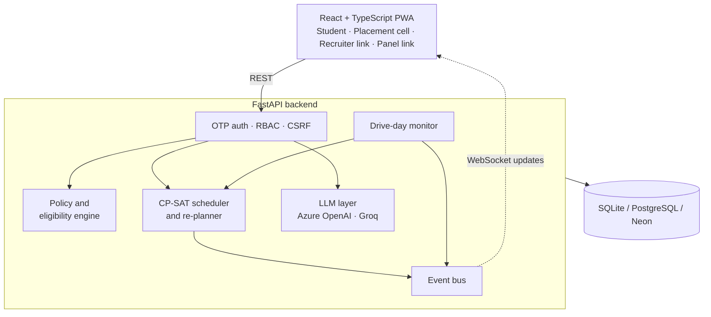

# HireFlo (DriveOps)

[](https://github.com/eashaanmano/HireFlo/actions/workflows/ci.yml)


**An operations layer for campus placement drives.**

Placement cells already run on spreadsheets, e-mail and recruiters' own portals. HireFlo doesn't replace any of that.
It wraps those tools and runs the drive on top of them:

- imports the cell's master sheet;
- explains every eligibility decision with the rule behind it;
- schedules interviews with a constraint solver;
- re-plans live when a panel runs late or a student doesn't show up;
- exports back to recruiters' own formats.

> SSL Lab project, M.Tech CSE, NIT Calicut. All student records are fictional and CTCs are illustrative.

---

## Why it exists

On drive day a placement cell coordinates hundreds of students, several interview panels and a recruiter, mostly by
phone calls and a shared sheet. One panel running 20 minutes late, or a few no-shows, and the day's plan is out of date.
Students wait without knowing when they're up, and nobody can quickly answer "am I eligible for this?" or "what do I
give up if I accept this offer?".

HireFlo answers those questions live, for everyone, from one event stream.

| Who | Signs in with | What they get |
| --- | --- | --- |
| **Student** | E-mail OTP (profile pre-imported, no signup) | "What needs you" dashboard, explained eligibility, live interview queue and ETA, offer what-ifs ("which drives would I lose?"), AI assistant |
| **Placement cell** | E-mail OTP (coordinator or admin) | Exceptions inbox, JD to rules with human approval, versioned policy engine, conflict-free scheduling, drive control room with one-click re-plans, analytics, audit log, simulator |
| **Recruiter** | Expiring magic link (no account) | Pool what-if before committing, shortlists and results as CSV, resume bundle, live panel progress, hiring funnel |
| **Interview panel** | Per-panel link | One screen: next candidate, resume, Start, Done |

When a panelist taps **Done**, the student's queue position, the cell's control room and the recruiter's progress
estimate all update at once over WebSockets.

## Highlights

**Constraint-based scheduling (OR-Tools CP-SAT)**
- Every waiting candidate gets a panel and a time with no clashes: a panel holds one interview at a time, and a
  student can't be in two places across rounds or drives.
- **Multi-day drives:** working hours, lunch breaks and skipped Sundays become the domain of each start time, so no
  interview crosses a break or the night. A round that doesn't fit in one day continues the next working day.
- **Live re-planning:** overruns, no-shows and a panel going down produce a re-plan proposal that the cell approves
  with one click. The objective balances an earlier finish against student waiting, penalises the single worst delay
  so no one student absorbs everyone's slack, and starts the search from the current plan for stability.
- **Drive simulator:** replays a drive day with random overruns and no-shows, fixed plan against live re-planning,
  using the same random draws for both.

**Explainable eligibility and policy**
- A deterministic policy engine with versioned rules: tiers (Regular, Dream, Super Dream), PSU rules and upgrade
  chances after an offer. Every "not eligible" names the rule code (P1–P6) and the exact reason.
- JD text becomes eligibility rules, each with the source sentence and a confidence score. Rules go live only after
  the cell approves them.

**Grounded AI assistant (optional)**
- One provider layer for **Azure OpenAI** and **Groq**, with task routing and automatic fall-back. Azure handles
  structured JD extraction; Groq handles fast streaming chat.
- Policy answers come from the policy engine and are passed to the model as facts it may not contradict.
- **Privacy by construction:** a student's name, roll number and e-mail, and any other student's data, never reach
  the model. The cell assistant sees totals only.
- Without an AI key, everything still works: the pattern-based extractor, policy-engine answers and a season summary
  take over.

**Production-minded details**
- Neon (serverless PostgreSQL) support, plus a one-command SQLite-to-Neon copy tool.
- Interactive charts that switch to tables, export CSV and act as click-to-filter controls. Data tables have search,
  column filters, sorting and a column picker.
- Installable PWA, rotating signed venue QR codes for check-in, and an append-only event log that doubles as the
  audit trail.

## Architecture



More detail: [docs/architecture.md](docs/architecture.md).

| Layer | Choice |
| --- | --- |
| API | FastAPI, Pydantic v2, SQLAlchemy 2.0 |
| Database | SQLite locally, PostgreSQL in Docker, Neon in the cloud |
| Scheduling | Google OR-Tools CP-SAT |
| Live updates | WebSockets over an append-only event log |
| AI | Azure OpenAI (v1 API) and Groq, with fall-back; deterministic extractor and policy engine without AI |
| Frontend | React 18, TypeScript, Vite, TanStack Query, React Router |
| Quality | pytest, Vitest and Testing Library, Ruff, GitHub Actions CI |
| Delivery | Docker Compose (PostgreSQL, API, nginx) |

---

## Quick start

### Option 1: Docker

```bash
docker compose up --build
```

Open **http://localhost:8080**. The first start seeds a demo season: about 180 students and 28 drives, including an AMD
drive that is **live right now**.

### Option 2: Local (Python 3.11+, Node 20+)

**Backend** (shown for Windows PowerShell; on macOS/Linux use `source .venv/bin/activate` and `cp`):

```powershell
cd backend
python -m venv .venv
.venv\Scripts\activate
pip install -r requirements-dev.txt
copy .env.example .env
python -m app.seed --reset
uvicorn app.main:app --reload --port 8000
```

**Frontend** (in a second terminal):

```powershell
cd frontend
npm install
npm run dev
```

Open **http://localhost:5173**. API docs are at http://localhost:8000/docs.

> Demo times are relative to the moment you seed. Re-seed shortly before a demo (`python -m app.seed --reset`) so
> the AMD drive is live.

### Demo accounts

Demo mode shows one-click sign-in on the landing page.

| Account | Role | What to show |
| --- | --- | --- |
| Eashaan Manohar | Student | Checked in for today's AMD interview: live queue position and ETA |
| Midhun Unnikrishna Pillai | Student | Pending offer below 10 LPA: sees which drives accepting would cost him |
| Harsh Kumar Kashyap | Student | Placed, with 1 of 2 upgrade chances used |
| Placement Cell Admin | Cell admin | Inbox with a re-plan, a dispute, rules to approve and a late arrival |

Recruiter and panel links are printed in the backend log and saved to `backend/seed/demo_links.txt`.

### Optional: Neon, Azure OpenAI, Groq

Put the keys in `backend/.env` (never commit it). The step-by-step setup, including activating the Azure for Students
credit, is in **[docs/NEON_AZURE_GROQ.md](docs/NEON_AZURE_GROQ.md)**.

---

## Five-minute demo

1. **Cell admin → Inbox.** Panel A of the AMD drive is running long and a re-plan is ready. Compare the before and
   after finish times, then approve.
2. **Control room.** Mark a student absent; a new re-plan appears within seconds.
3. **Panel link** on a phone: Start, then Done. Watch the control room and the student's queue update live.
4. **Eashaan** on a second device: the drive-day banner shows his panel, room, people ahead and ETA.
5. **Midhun → Offers.** Before accepting, he sees exactly which drives he'd lose.
6. **Recruiter link.** Drag the CGPA slider to see the eligible pool change, then send the change to the cell as
   rules to approve.
7. **Cell → Drives → Schedule.** Set 09:00–11:00 with one panel and "up to 2 days". The solver spreads the round over
   two days.
8. **Cell → Simulator.** Compare a fixed plan with live re-planning under heavy overruns and no-shows.

## Tests

```bash
cd backend && pytest && ruff check app tests
cd frontend && npm test && npm run typecheck
```

The backend suite (100+ tests) covers the policy engine, eligibility, JD extraction, the CP-SAT scheduler and
multi-day windows, re-planning, the importer, the LLM routing and privacy, the Neon copy tool, and API flows. CI runs
everything on every push.

## Configuration

All settings are environment variables or entries in `backend/.env`; see [`backend/.env.example`](backend/.env.example).
The ones that matter most:

| Variable | Purpose |
| --- | --- |
| `DATABASE_URL` | SQLite by default; paste a Neon or PostgreSQL URL to switch |
| `SECRET_KEY` | **Set a long random value in production** (signs sessions, links and check-in codes) |
| `DEMO_MODE` | Shows OTPs on screen and demo accounts. **Turn off in production** |
| `PUBLIC_URL` | Base URL for recruiter and panel links and the venue QR |
| `WORK_DAY_START`, `WORK_DAY_END`, `WORK_BREAKS`, `SCHEDULE_MAX_DAYS` | Default interview hours for multi-day scheduling |
| `AZURE_OPENAI_*`, `GROQ_API_KEY` | Optional AI providers |

## Security

- Passwordless OTP sign-in: codes are HMAC-hashed, expire in 10 minutes and are rate-limited per IP and e-mail.
- Signed session cookies (`HttpOnly`, `SameSite=Lax`), CSRF header on every cookie-authenticated write, and
  role-based plus row-level access checks on the server.
- Recruiters see aggregates for the pool and personal details only for students who applied.
- Pydantic validation on every request; resume uploads limited to PDFs of up to 2 MB.
- Strict security headers (CSP, `X-Frame-Options`, `Referrer-Policy: no-referrer`) and an audit log of every
  decision and override.

## Project structure

```
backend/
  app/
    core/       config, database, auth dependencies, rate limiting
    services/   scheduler (CP-SAT), working hours, live drive-day ops, policy and eligibility,
                JD extraction, LLM layer and assistant, insights, importer, simulator, event bus
    routers/    auth, student, cell, recruiter link, panel link, WebSocket
    models.py   SQLAlchemy models
    seed.py     fictional demo season with a live drive
  tests/        pytest suite
frontend/
  src/
    pages/      student, cell, recruiter and panel views
    components/ UI kit, charts, data tables, assistant, schedule board
    lib/        auth, live updates, formatting
    api/        typed client and types
docs/           architecture, Neon/Azure/Groq setup, SRS
```

## Team

| Member | Role | Owns |
| --- | --- | --- |
| Eashaan Manohar | Tech lead | Architecture and data model, core API, auth and security, event bus, CP-SAT scheduler and re-planning, simulator, deployment and CI |
| Midhun Unnikrishna Pillai | AI and rules | JD extraction, policy engine, policy Q&A |
| Harsh Kumar Kashyap | Frontend | UI and PWA for all actors, notifications, QR check-in |

---

Company names are used as sample data for an academic demo. Roles, CTCs and job descriptions are illustrative, and
every student record is fictional.
