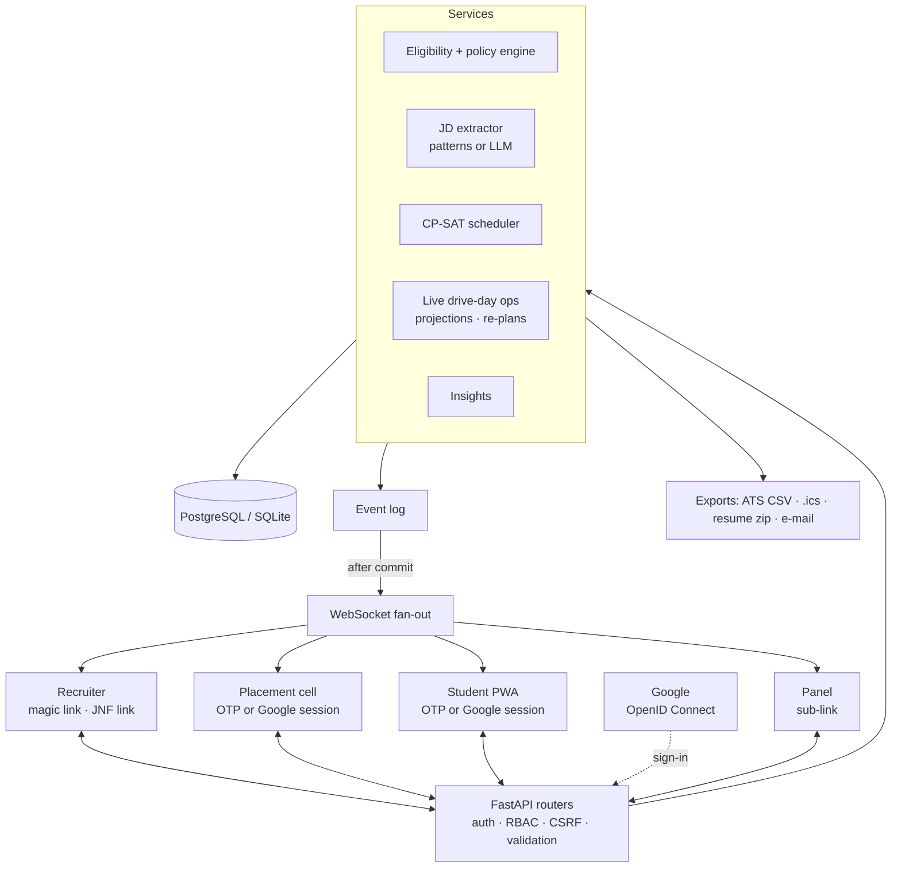

# DriveOps architecture

## Data flow



Every state change calls `services.events.emit()`. The event row is written in the same transaction as the change;
after the commit, a minimal notice (event type and ids, never personal data) is pushed to every connected screen,
and each screen refetches what it shows. The same rows form the audit log and feed analytics.

## Module boundaries

| Module | Depends on | Responsibility |
| --- | --- | --- |
| `services/scheduler.py` | OR-Tools only | Pure CP-SAT model in integer minutes. No database, fully unit-tested, plus an independent `validate()` checker for every hard constraint |
| `services/live.py` | scheduler, models | Converts slots to solver inputs: first schedules, projections, re-plan proposals, slot state machine |
| `services/policy.py` | pydantic | Versioned policy config and policy checks with stable rule codes (P0–P5) |
| `services/eligibility.py` | policy | Rules + policy → decision with a reason per check |
| `services/jd_parser.py` | httpx (optional LLM) | JD → proposed rules with source sentence and confidence |
| `services/insights.py` | eligibility, live | Student, cell and recruiter dashboards |
| `routers/*` | services, schemas | HTTP only: auth, validation, scoping, commits |

## Drive-day state machine (slot)

```
scheduled ──start──▶ in_progress ──complete(pass|fail)──▶ done
    │                                                   └─ pass + next interview round scheduled → new slot in that queue
    └─no-show──▶ no_show ──late check-in──▶ scheduled (and a re-plan is drafted)
```

## Links without accounts

Signed tokens (HS256, `SECRET_KEY`) with a kind each, so one can never stand in for another:

| Kind | Scope | Lifetime | Revoked by |
| --- | --- | --- | --- |
| `recruiter` | one drive | 21 days | rotating the drive's link version |
| `panel` | one panel of one drive | 21 days | rotating the drive's link version |
| `jnf` | one company's job notification form | 30 days | "New link" on the form (bumps its version) |
| `checkin` | one drive's venue QR | 90 seconds | expiry |

A job notification form is stored in `job_notifications` (status `invited → submitted → changes_requested →
submitted … → approved | declined`). The company sees its own form and aggregate counts only; approval creates the
drive, its rounds and the form's criteria as approved rules, and opens it when no JD-extracted rule is left to approve.

## "You're up next" alerts

`live.call_next()` runs from the monitor, after a panel marks an interview done and after a re-plan is approved. A
waiting slot is called once (a `slot.called` event dedupes it) when it is projected to start within
`CALL_AHEAD_MIN` (15) minutes, or when at most `CALL_AHEAD_COUNT` (2) interviews are ahead and it starts within the
hour. The projection is the one the student's drive-day banner shows.

## Re-planning

Triggered by a no-show, a late arrival, a panel running more than `DELAY_THRESHOLD_MIN` behind, or the cell. The solver
re-optimises every not-yet-started slot from *now*:

- panels become available when their current interview is projected to end;
- students not yet on site can't be pulled earlier than 15 minutes before their communicated time;
- the objective finishes the day earliest first, then pulls checked-in students forward, then minimises panel changes
  and time shifts so the plan stays recognisable.

The result is a proposal with before/after metrics. Nothing changes until the cell approves it; slots that started in
the meantime are skipped safely.
